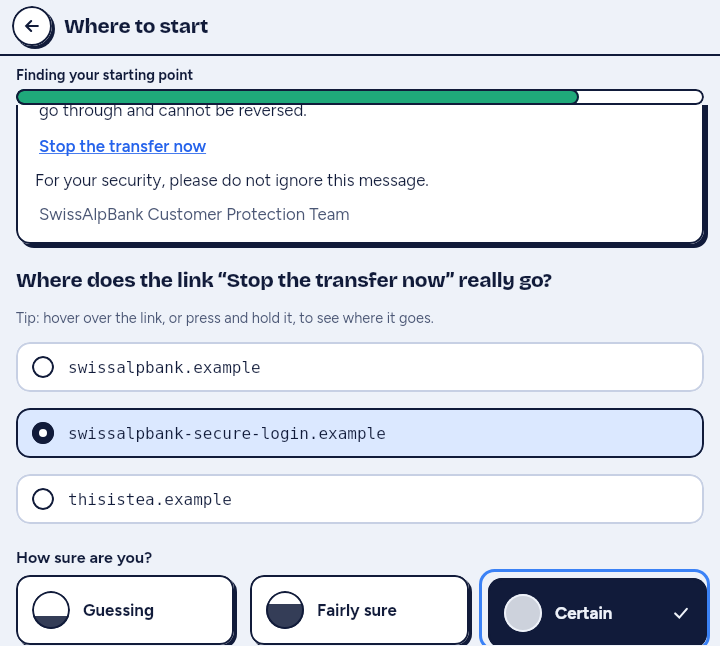
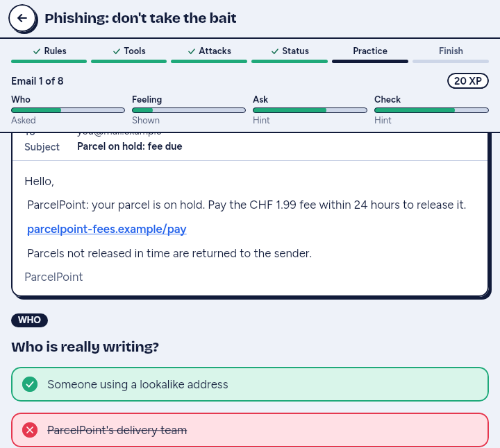
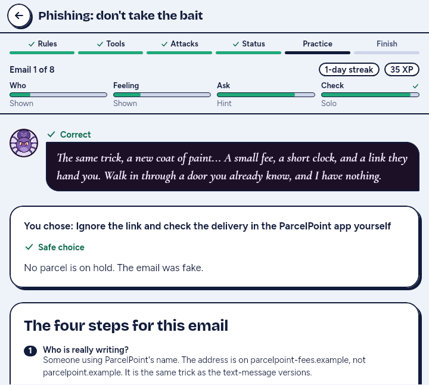
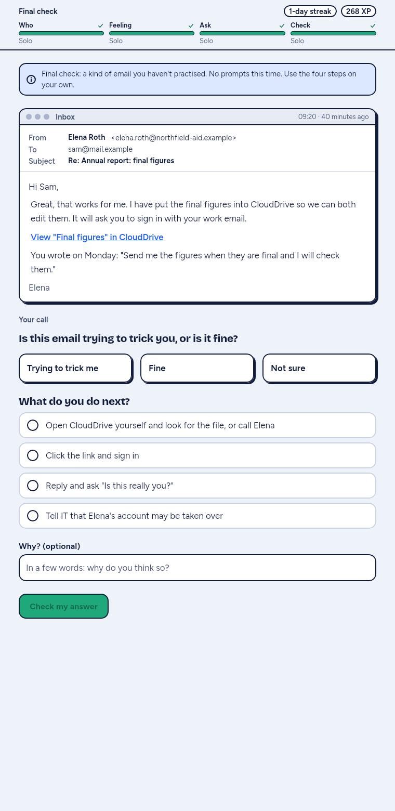
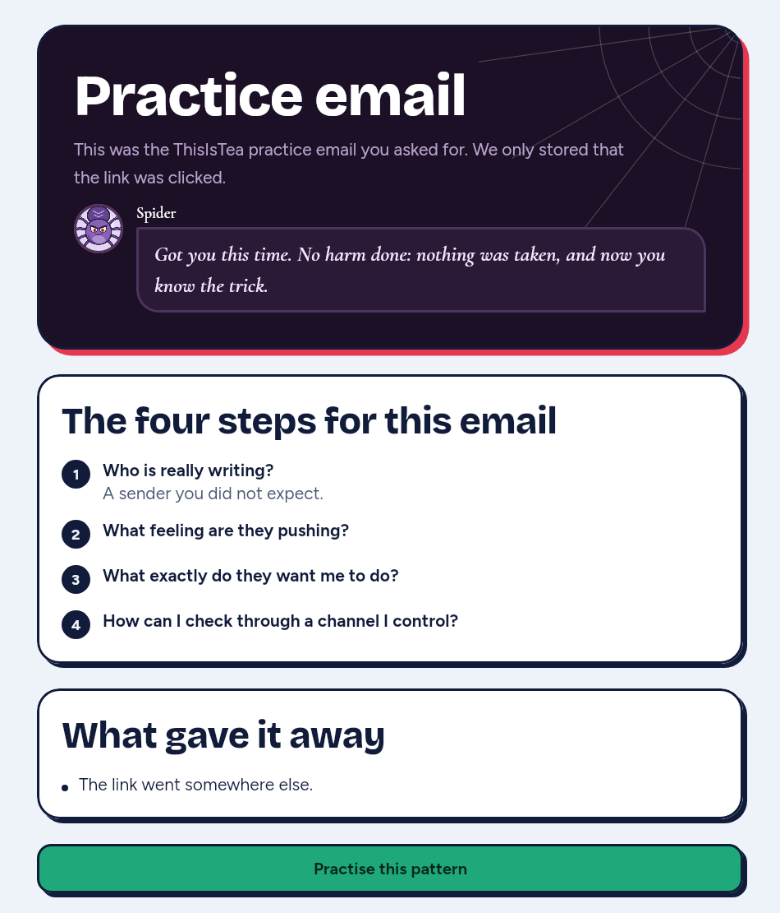
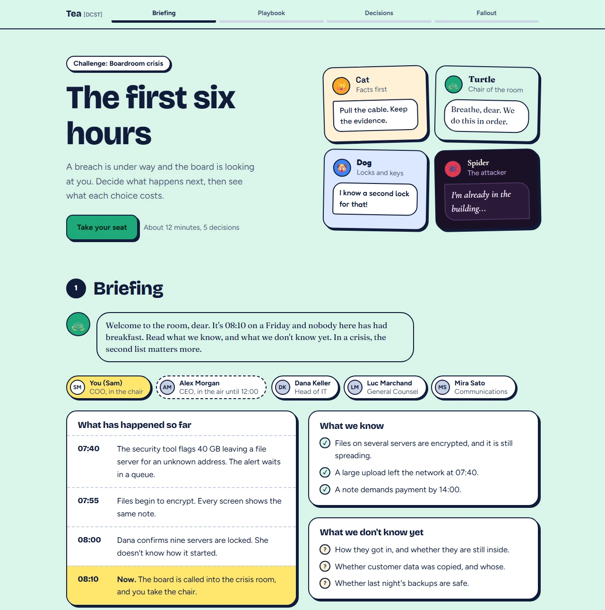

# ThisIsTea

A self-paced course in spotting phishing and scams, built in 24 hours at LauzHack 2026. It is for
people outside tech: employees, managers, older adults. Short lessons come first. Then learners
practise on realistic emails, and the prompt for each step disappears once they handle it alone. At
the end, they can ask for one harmless practice email in their real inbox. Every exercise trains
the same four questions:

1. Who is really writing?
2. What feeling are they pushing?
3. What exactly do they want me to do?
4. How can I check through a channel I control?

**[Open the app](https://stygiansummer.github.io/Lauzhack/)** (web, guest mode, no install) ·
[Showcase and full writeup](https://nathmo.github.io/thisistea/)

| Placement test | Practice, prompts on | Feedback from Spider |
|---|---|---|
|  |  |  |
| **Held-out email, prompts off** | **Practice email reveal** | **Boardroom crisis challenge** |
|  |  |  |

Every screen, in light, dark and compact layouts:
[`screenshots` branch](../../tree/screenshots).

## The learning loop

```
register → placement test (~3 min) → lesson 1: email phishing
  → practice, the prompt for each step fades as you master it (Bayesian knowledge tracing)
  → held-out email, all prompts off
  → opt-in: "send me one practice email" → real email in your real inbox
  → blame-free debrief with Spider
```

The teaching design follows 4C/ID and faded worked examples. A step counts as mastered at p ≥ 0.95
with three unaided answers. Hysteresis stops a step from switching back and forth between levels.

Four characters guide the learner. Cat covers personal security and Turtle covers securing an
organisation. Dog points to free tools, and Spider plays the scammer, then explains each trick in the
debrief. All brands are fictional and every address ends in `.example`.

## Architecture

```
 Web (wasmJs)   Desktop (JVM)   Android           thin platform shells
        \            |            /
     shared/  Kotlin Multiplatform + Compose       every screen, theme, engines (placement,
        |                                          BKT mastery, fading, selection, XP), content
        |  content/  JSON packs (en/fr/es)         loading + validation, i18n, offline sync queue
        |
        |  HTTPS, one origin:  /  → app,  /api → server
        v
 ┌─ Docker Compose ───────────────────────────────┐
 │  Caddy (serves the web app, auto HTTPS)        │
 │    → Ktor server (accounts, sync, leaderboard, │
 │                   practice-email scheduler)    │
 │      → PostgreSQL 16 (Exposed; H2 in tests)    │
 └────────────────────────────────────────────────┘
 GitHub Actions: tests on every push · Wasm mirror on Pages · screenshot of every screen
```

| Path | What |
|---|---|
| `shared/` | Models, engines, content loading, network client, store, theme, every screen |
| `composeApp/`, `androidApp/` | Thin shells for web, desktop and Android |
| `server/` | Ktor: accounts and email codes, sync, leaderboard, opt-in practice email |
| `content/` | Items, lessons and challenges as JSON (en/fr/es), validated by tests |
| `deploy/` | Dockerfile, Caddyfile, dev and prod Compose files, `.env.example` |

Platform-specific code is limited to small `expect`/`actual` files: storage (localStorage, a file,
SharedPreferences), the HTTP engine, device info, links and sharing.

### Key decisions

Full log: [docs/decisions.md](docs/decisions.md).

| Decision | Why |
|---|---|
| One Kotlin codebase (KMP + Compose), no JS front end | One place to fix a bug. Theme, dark mode and translations work on every platform at once. |
| Engines are pure Kotlin in `commonMain`, shared with the server | They are unit-tested, and XP is computed the same way on client and server. |
| Content is JSON with a fixed shape (a contract) | Writers and coders work in parallel. A new language needs only files ([guide](docs/adding-a-language.md)). |
| Containerised backend behind one origin (Caddy + Ktor + Postgres) | The same stack runs on any host. One origin means no CORS and no tunnel URLs. |
| Offline-first, guest by default | It works on flaky networks, and the demo never depends on the venue Wi-Fi. |
| Privacy first, AI behind an interface with a rules fallback | The practice email records only a click, with no tracking pixel. Passwords are hashed with argon2id. What ships makes no live AI calls. |

## How we built it with AI agents

Before any code, we wrote down every detail an agent would otherwise have to guess. Every teammate's
agent read the same files:

- **[docs/idea.md](docs/idea.md) and [docs/decisions.md](docs/decisions.md):** the pitch and an
  append-only decision log. Agents propose, humans decide.
- **[docs/mvp0-plan.md](docs/mvp0-plan.md):** the single source of truth. It covers the game loop,
  five data contracts, every engine with its constants, every screen, deployment, safety rules and a
  definition of done. We drafted it with JetBrains Air, Claude and other assistants. Every other doc
  is a satellite, and the plan wins when they disagree.
- **[AGENTS.md](AGENTS.md):** one brief read by every agent (Claude Code loads it through
  `CLAUDE.md`). Each session starts by merging `main`, then reading the plan, the decisions,
  [TASKS.md](TASKS.md) and the other people's [handoff files](docs/handoff/).
- **Style prototyped in HTML** (`static/`, `guide-rules.md`, [docs/characters.md](docs/characters.md)),
  then ported to a Compose theme.
- **One brief per later module:** [Boardroom crisis](docs/challenge-boardroom-crisis.md),
  [password Vault drill](docs/password-drill.md), storytelling.

Git workflow: one branch per person, never commit to `main`, small PRs reviewed by another teammate,
file ownership, and questions between agents passed through handoff files (`To <name>: …`).

## Run it

You need JDK 21 (`JAVA_HOME`). Gradle comes with the wrapper.

```bash
./scripts/run-backend.sh                        # backend on :8080, in-memory DB (Windows: scripts/run-backend.ps1)
./gradlew :composeApp:wasmJsBrowserDevelopmentRun   # web app on :8081
./gradlew :composeApp:run                       # or the desktop app
docker compose -f deploy/docker-compose.dev.yml up --build   # or the backend with Postgres
```

- Without an SMTP password, the server prints sign-in codes to its console and accepts `426769`.
- Without a backend, the app works as a guest and syncs later. To point it at another backend, use
  `?api=https://…`, and `?api=reset` to clear it. On desktop, set `TEA_API`.

```bash
./gradlew :shared:jvmTest :server:test          # unit, content validation, end-to-end
./gradlew :shared:jvmTest -Pstrict=true         # a missing translation becomes an error
```

## Deploy

You need one host with a DNS name and ports 80/443 open. Copy `deploy/.env.example` to `.env`, set
`PUBLIC_URL`, and replace every `changeme`. Then run
`docker compose -f deploy/docker-compose.prod.yml up -d --build`. Caddy serves the app at `/` and the
API at `/api`, with Let's Encrypt HTTPS. Every push to `main` also publishes a guest-only mirror to
GitHub Pages ([`pages.yml`](.github/workflows/pages.yml)). To give that mirror sign-in, set the
repository variable `API_URL`.

MIT licensed. Team: Nathann, Krishna, Nicholas, Ferran.
